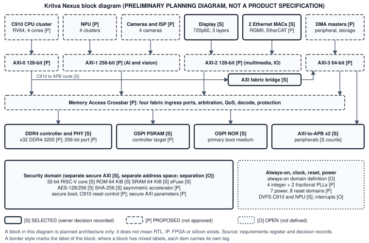

# Kritva Nexus Preliminary Datasheet

| Property | Value |
|---|---|
| Document ID | KOS-NEXUS-DS-001 |
| Repository | `KritvaOS/kritva-nexus` |
| Document Type | Datasheet |
| Status | DRAFT |
| Owner | Dinesh |
| Reviewer / Approver | Dinesh (interim, not independent); no approval record exists yet |
| Version | 0.1.0-draft |
| Last Updated | 2026-11-11 |
| Authority | DERIVED (not AUTHORITATIVE) |
| Related Tasks / Milestones | KOS-NEXUS-085; NX-M1 |
| Related Documents | [requirements](../requirements/REQUIREMENTS.md); [decisions](../decisions/DECISIONS.md); [system architecture](../architecture/SYSTEM_ARCHITECTURE.md); [interconnect specification](../architecture/INTERCONNECT_SPECIFICATION.md); [block diagram](nexus_block_diagram.svg) |

## Purpose

**PRELIMINARY PLANNING DATASHEET, NOT A PRODUCT SPECIFICATION.** This datasheet lists the planned blocks of the Kritva Nexus SoC, a consolidated feature summary and the individual features of each block. It is a derived, non-authoritative summary of the [requirements register](../requirements/REQUIREMENTS.md) (NX-REQ-001 to NX-REQ-091) and the [decision records](../decisions/DECISIONS.md) (NX-DEC-001 to NX-DEC-023). Where it differs from them, the register and the approved decision records win. It adds no value of its own.

No RTL, FPGA image or silicon exists, and no figure here is measured. "Planned" means required by the register; it does not mean built. Every row names the requirements it restates and their label: **SELECTED** (an owner decision is recorded), **PROPOSED** (recommended, not approved, shown as preliminary and not committed) or **OPEN** (not yet defined). A frequency, bandwidth, TOPS or power figure is a target or a planning figure, never an achieved result.

## 1. Overview and consolidated features

Kritva Nexus is planned as an application SoC with a four-core RV64 application CPU cluster, DDR4 system memory, a camera, ISP and NPU vision path, display and dual-Ethernet connectivity, an isolated security domain and a standard peripheral set. Its internal communication is planned as four application AXI fabrics, a Memory Access Crossbar and two AXI-to-APB interconnects. The Kritva Nexus Simulator, FPGA prototype and block-level physical design are planned separately and are not part of this datasheet.

| Feature area | Consolidated feature (planned) | Label | NX-REQ |
|---|---|---|---|
| Application CPU | Xuantie C910, RV64, four cores, shared 1 MB L2 | PROPOSED | 001, 055 |
| Memory | DDR4 primary memory; Octal SPI PSRAM; OSPI NOR boot medium | SELECTED | 002, 003, 004 |
| Interconnect | Four application AXI fabrics; two AXI-to-APB interconnects | SELECTED | 015, 016 |
| AI and vision | Four-camera input, ISP, four-cluster NPU, 6 MiB camera frame pool | frame pool SELECTED; others PROPOSED | 005, 042, 045, 046 |
| Display | 720p60 parallel DPI, three composition layers | SELECTED | 006, 007 |
| Ethernet | Two independent MACs; RGMII and EtherCAT MainDevice operation | MACs SELECTED; modes PROPOSED | 008, 040, 041 |
| Peripherals | 16 PWM, 32 GPIO, 4 timers, 4 UART, 4 I2C, 1 SPI master, 1 SPI slave, 2 I2S (counts only) | SELECTED | 019 to 026 |
| Security | Isolated 32-bit RISC-V core, 64 KiB ROM and SRAM, eFuse, AES, SHA-256, separate secure AXI | SELECTED | 009 to 014, 032 |
| Clock and power | DVFS for the C910 and the NPU | SELECTED | 017, 018 |
| Always-on, interrupts | Always-on domain and interrupt architecture | OPEN | 031, 057 |
| Engineering baseline | RTL design standard KNX-RTL-STD-001 for all design RTL | SELECTED | 082 to 089 |

### Block list

| Block | Role (planned) | NX-REQ |
|---|---|---|
| C910 CPU cluster | Application processing | 001, 055, 056 |
| AXI-0, AXI-1, AXI-2, AXI-3 | Application fabrics | 015, 050, 051, 079 |
| Memory Access Crossbar | Arbitration, QoS, decode and protection toward memory | 049, 078 |
| AXI fabric bridge (AXI-0 to AXI-3) | C910 route to peripherals | 067, 071, 081 |
| AXI-to-APB-0 and APB-1 | Peripheral register access | 016, 052 |
| DDR4 controller and PHY | Primary system memory | 002, 030, 064, 076 |
| OSPI PSRAM and OSPI NOR controllers | Secondary memory and boot medium | 003, 004, 065 |
| Cameras, ISP, frame pool | Image capture and processing | 005, 042 to 045 |
| NPU | Neural-network acceleration | 046, 047 |
| Display compositor and DPI | Display output | 006, 007, 048 |
| Ethernet MACs (two) | Network and EtherCAT | 008, 040, 041 |
| Peripheral subsystem | PWM, GPIO, timers, UART, I2C, SPI, I2S | 019 to 026 |
| Security domain | Secure boot and cryptography | 009 to 014, 032 to 039 |
| Always-on, clock, reset, power | Clocks, PLLs, power and reset domains, interrupts | 017, 018, 031, 057 to 063, 066 |

## 2. Application CPU, interconnect and memory

| Feature | Planned value or description | Label | NX-REQ |
|---|---|---|---|
| CPU IP | Xuantie C910 | PROPOSED (NX-DEC-018) | 001 |
| CPU cluster | RV64 single cluster, four cores, shared 1 MB L2, 64 KB L1 instruction and data cache per core; target 1.0 to 1.2 GHz | PROPOSED | 055, 059 |
| CPU bus interface | AXI4, 128-bit, 8 outstanding reads and 8 writes | PROPOSED | 056 |
| CPU DVFS | Supported | SELECTED | 017 |
| Application AXI fabrics | Four fabrics | SELECTED | 015 |
| Fabric roles and widths | AXI-0 main, CPU, memory at 128 bits; AXI-1 AI and vision at 256 bits; AXI-2 multimedia and high-speed IO at 128 bits; AXI-3 peripherals, control and DMA at 64 bits; 400 to 600 MHz each | PROPOSED | 050, 051 |
| Fabric behaviour | AXI4, address decode, DECERR for an unmapped address, AxQOS carried | PROPOSED | 079 |
| Memory Access Crossbar | Separate crossbar with four fabric ingress ports: arbitration, QoS, address decode, access protection | PROPOSED | 049 |
| Arbitration classes | Four classes in priority order: display; Ethernet DMA; C910; NPU and other DMA; no starvation of the lowest | PROPOSED | 078 |
| AXI-to-APB interconnects | Two; 32-bit APB (APB4) at a 200 to 250 MHz target | count SELECTED; parameters PROPOSED | 016, 052, 081 |
| C910 route to peripherals | C910, AXI-0, AXI fabric bridge, AXI-3 decode, AXI-to-APB | SELECTED | 067, 071 |
| C910-to-APB behaviour | DECERR unmapped, SLVERR denied or APB error; default-deny address windows checked before issue; strongly ordered, one access per target; single-beat only; in-flight access completes SLVERR at reset; C910 only | SELECTED | 068, 070, 072 to 075 |
| C910-to-APB timeout | Hung target returns SLVERR (SELECTED); timeout of 1024 bridge-clock cycles (PROPOSED) | SELECTED / PROPOSED | 069, 080 |
| DDR4 primary memory | DDR4 | SELECTED | 002 |
| DDR4 interface | One x32 data channel at DDR4-3200 (3200 MT/s); capacity chosen at board level up to the 64 GiB window | PROPOSED | 064, 076 |
| DDR4 ingress | One 256-bit AXI4 port at 500 MHz from the crossbar | PROPOSED | 030 |
| DDR4 planning figures | Theoretical peak 12.8 GB/s; 70% sustained fraction (8.96 GB/s); budgets display 0.664, Ethernet 0.500, optional camera 0.049, C910 2.0, NPU 5.0, headroom 0.747 GB/s. Sizing figures, not measurements | PROPOSED | 077 |
| Secondary memory | Octal SPI PSRAM; controller target 200 to 400 MHz | SELECTED; target PROPOSED | 003, 065 |
| Boot medium | OSPI NOR | SELECTED | 004 |
| Application address map | 40-bit map proposed; address width not yet confirmed against the C910 configuration | PROPOSED / OPEN | 053, 029 |
| Secure and application address spaces | Separation and treatment of overlapping ranges not yet defined | OPEN | 028 |

## 3. AI and vision

| Feature | Planned value or description | Label | NX-REQ |
|---|---|---|---|
| Camera inputs | Four simultaneous cameras, up to 640x640 at 10 FPS each, Bayer RAW10 and RAW12 | PROPOSED | 042 |
| Camera frame pool | 6 MiB usable capacity | SELECTED | 005 |
| Frame drop | With no buffer available a whole frame is dropped; a partial frame is never exposed as valid | PROPOSED | 043 |
| Frame release | A source frame is released after source consumption, independent of inference completion | PROPOSED | 044 |
| ISP | Bayer to RGB through unpacking, black level, defect pixel, lens shading, demosaic, white balance, colour correction and gamma; stage order not yet specified | PROPOSED | 045 |
| NPU | Four homogeneous clusters, INT8 inputs and weights, INT32 accumulators; target 8 TOPS INT8 peak (a target, not an achieved figure); target clock 800 MHz | PROPOSED | 046, 059 |
| NPU DVFS | Supported | SELECTED | 018 |
| Local memories | Camera frame pool, ISP local SRAM and NPU local SRAM; normal path needs no DDR intermediate storage | PROPOSED | 047 |
| ISP clock | Target 600 MHz | PROPOSED | 059 |

## 4. Multimedia, connectivity and peripherals

| Feature | Planned value or description | Label | NX-REQ |
|---|---|---|---|
| Display mode | 720p60 (1280x720 at 60 Hz), parallel DPI | SELECTED | 006 |
| Display layers | Three composition layers | SELECTED | 007 |
| Display compositor | Three independent framebuffers in DDR4, alpha composition, z-order, atomic update at Vsync, underflow detection | PROPOSED | 048 |
| DPI pixel clock | Target 74.25 MHz | PROPOSED | 059 |
| Ethernet MACs | Two independent MACs | SELECTED | 008 |
| Ethernet interface | 10/100/1000 Mbps over RGMII with external PHYs | PROPOSED | 040 |
| EtherCAT | MainDevice operation using raw Ethernet frames; EtherType 0x88A4 not rejected by receive filtering | PROPOSED | 041 |
| PWM | 16 channels | SELECTED | 019 |
| GPIO | 32 | SELECTED | 020 |
| Timers | Four general-purpose timers | SELECTED | 021 |
| UART | Four | SELECTED | 022 |
| I2C | Four masters | SELECTED | 023 |
| SPI | One master and one slave | SELECTED | 024, 025 |
| I2S | Two masters | SELECTED | 026 |

Peripheral rows select the counts only (NX-DEC-020); capabilities, timing and pin allocation are not decided.

## 5. Security, always-on, clock, reset and power

| Feature | Planned value or description | Label | NX-REQ |
|---|---|---|---|
| Security core | Dedicated, isolated 32-bit RISC-V core; target clock 200 to 400 MHz | SELECTED; clock PROPOSED | 009, 059 |
| Security memories | 64 KiB ROM and 64 KiB SRAM for the security core; dedicated eFuse | SELECTED | 010, 011, 012 |
| Cryptography | AES-128 and AES-256; SHA-256; an asymmetric accelerator whose algorithms are not yet defined | AES, SHA SELECTED; asymmetric PROPOSED | 013, 014, 035 |
| Secure interconnect | Dedicated, separate secure AXI interconnect; 32-bit data and address, 2 outstanding reads and 2 writes | concept SELECTED; parameters PROPOSED | 032, 033 |
| Application exclusion | Application AXI cannot reach security ROM, SRAM, eFuse, key management or the security interrupt controller; raw secrets not exposed through application interfaces | PROPOSED | 034, 039 |
| Secure boot | Security core starts first, authenticates the OSPI NOR image from immutable ROM and authorises C910 reset release; C910 reset is hardware-controlled by the security domain; a C910 warm reset does not reset it | PROPOSED | 036, 037, 038 |
| Secure address map | Separate secure address space proposed | PROPOSED | 054 |
| Always-on domain | Responsibilities and interfaces not yet defined | OPEN | 031 |
| Critical faults | Thermal, power and tamper faults get a hardware response independent of application CPU execution | PROPOSED | 063 |
| PLLs | Four integer and two fractional PLLs | PROPOSED | 058 |
| Clock targets | C910 1.0 to 1.2 GHz; NPU 800 MHz; ISP 600 MHz; AXI fabrics 400 to 600 MHz; APB 200 to 250 MHz; PSRAM controller 200 to 400 MHz; DPI 74.25 MHz (targets) | PROPOSED | 059 |
| Power domains | Seven: AON, SEC, CPU, MEM, AI, MEDIA, IO; SoC power target 10 to 20 W (a target) | PROPOSED | 060, 066 |
| Reset domains | Eight: AON, SEC, CPU, MEM, AI, ISP, DISP, IO; asynchronous assertion, synchronous deassertion | PROPOSED | 061 |
| CDC and RDC | Every crossing uses a synchroniser, asynchronous FIFO or reset synchroniser and is checked, with documented waivers | PROPOSED | 062 |
| Interrupts | Application controller with 128 sources, security controller with 32, always-on controller with 8 to 16 wake sources; PLIC versus AIA not decided | OPEN | 057 |
| DVFS | C910 and NPU | SELECTED | 017, 018 |

## 6. Open items, design baseline and status

| Open or provisional item | Status | NX-REQ |
|---|---|---|
| Application address width against the selected C910 configuration (NX-ARCH-GAP-003) | OPEN | 029 |
| Separation of secure and application address spaces (NX-ARCH-GAP-002) | OPEN | 028 |
| Always-on domain definition | OPEN | 031 |
| Interrupt architecture | OPEN | 057 |
| C910 CPU selection | PROPOSED | 001 |
| DDR4 ingress port, width and bandwidth sizing | PROPOSED | 030, 064, 076, 077 |
| Every frequency, TOPS and power figure | Target or planning figure only | 046, 059, 066, 077 |

**Design baseline.** All Kritva Nexus design RTL is required to follow the RTL Design Standard KNX-RTL-STD-001 (approved as NX-DEC-023; NX-REQ-082 to 089 SELECTED). Its methodology defaults and automated compliance checks are PROPOSED (NX-REQ-090, 091), and no checker, library or RTL exists yet.

**Status and limits.** This is a preliminary planning datasheet derived from the requirements register and decision records and is not a product specification. A block or feature listed here does not mean RTL, IP, FPGA or silicon exists. It contains no performance achieved, timing, power, area, package, process or production-readiness claim, and it makes no statement about the availability or licence of any external IP. It has no approval record: its approval is separate from the approval of any standard or decision. The generated PDF names the source commit it summarises.

| Version | Date | Change |
|---|---|---|
| 0.1.0-draft | 2026-11-11 | First draft for KOS-NEXUS-085, derived from NX-REQ-001 to NX-REQ-091 and NX-DEC-001 to NX-DEC-023 |
