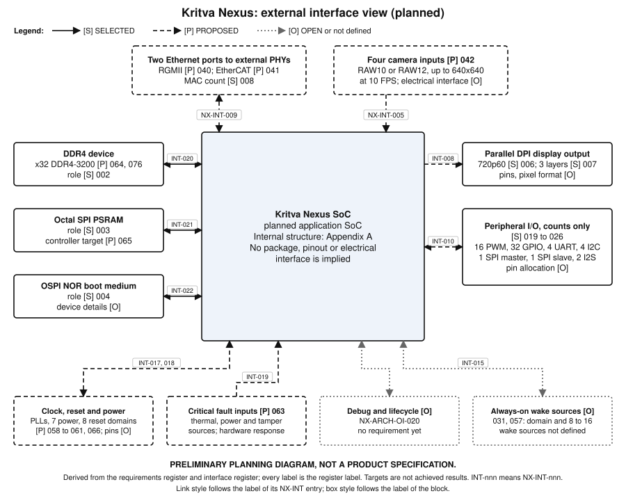
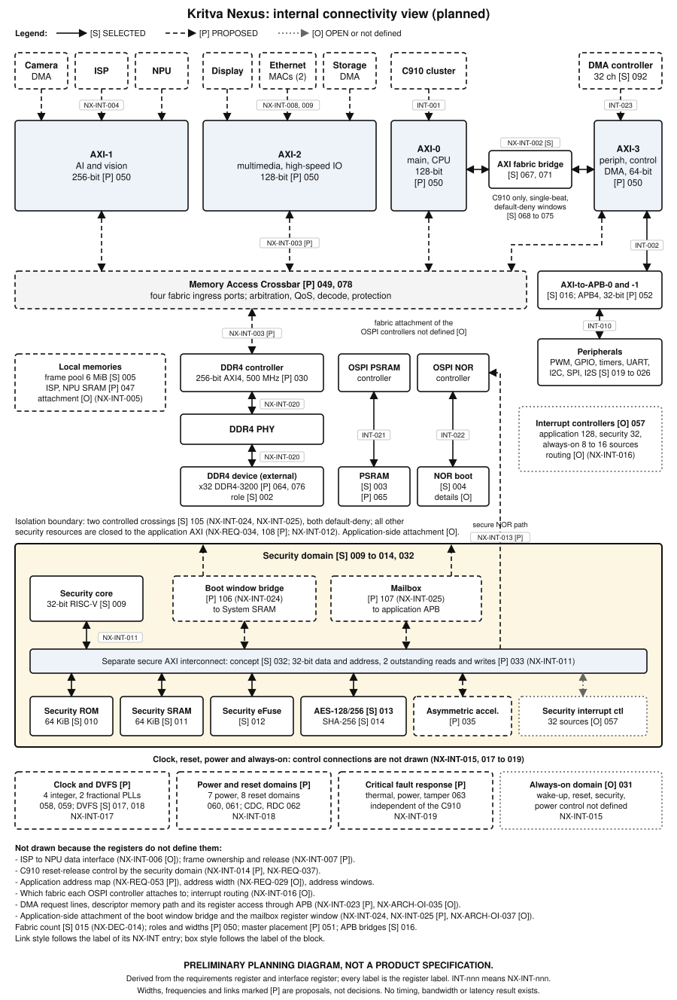

# Kritva Nexus Preliminary Datasheet

| Property | Value |
|---|---|
| Document ID | KOS-NEXUS-DS-001 |
| Repository | `KritvaOS/kritva-nexus` |
| Document Type | Datasheet |
| Status | DRAFT |
| Owner | Dinesh |
| Reviewer / Approver | Dinesh (interim, not independent); no approval record exists yet |
| Version | 0.3.1-draft |
| Last Updated | 2026-11-12 |
| Authority | DERIVED (not AUTHORITATIVE) |
| Related Tasks / Milestones | KOS-NEXUS-085; NX-M1 |
| Related Documents | [requirements](../requirements/REQUIREMENTS.md); [decisions](../decisions/DECISIONS.md); [system architecture](../architecture/SYSTEM_ARCHITECTURE.md); [interconnect specification](../architecture/INTERCONNECT_SPECIFICATION.md); [external interface diagram](nexus_external_interfaces.svg); [internal connectivity diagram](nexus_internal_connectivity.svg) |

## Purpose

**PRELIMINARY PLANNING DATASHEET, NOT A PRODUCT SPECIFICATION.** This datasheet lists the planned blocks of the Kritva Nexus SoC, a consolidated feature summary, the planned external interfaces, the planned internal connectivity and the individual features of each block. It is a derived, non-authoritative summary of the [requirements register](../requirements/REQUIREMENTS.md) (NX-REQ-001 to NX-REQ-100), the [decision records](../decisions/DECISIONS.md) (NX-DEC-001 to NX-DEC-025) and the interface register in the [system architecture](../architecture/SYSTEM_ARCHITECTURE.md) (NX-INT-001 to NX-INT-023). Where it differs from them, the register and the approved decision records win. It adds no value of its own.

No RTL, FPGA image or silicon exists, and no figure here is measured. "Planned" means required by the register; it does not mean built. Every row names the requirements it restates and their label: **SELECTED** (an owner decision is recorded), **PROPOSED** (recommended, not approved, shown as preliminary and not committed) or **OPEN** (not yet defined). Where the requirements of one row carry different labels, the label column gives each label with its requirement numbers. A frequency, bandwidth, TOPS or power figure is a target or a planning figure, never an achieved result.

*Figure 1. External interface view (planned). INT-nnn means NX-INT-nnn.*

## 1. Overview and consolidated features

Kritva Nexus is planned as an application SoC with a four-core RV64 application CPU cluster, DDR4 system memory, a camera, ISP and NPU vision path, display and dual-Ethernet connectivity, an isolated security domain and a standard peripheral set. Its internal communication is planned as four application AXI fabrics, a Memory Access Crossbar and two AXI-to-APB interconnects, with a separate secure AXI interconnect for the security domain. The Kritva Nexus Simulator, FPGA prototype and block-level physical design are planned separately and are not part of this datasheet.

| Feature area | Consolidated feature (planned) | Label | NX-REQ |
|---|---|---|---|
| Application CPU | Xuantie C910, RV64, four cores, shared 1 MB L2 | PROPOSED | 001, 055 |
| Memory | DDR4 primary memory; Octal SPI PSRAM; OSPI NOR boot medium | SELECTED | 002, 003, 004 |
| Interconnect | Four application AXI fabrics; two AXI-to-APB interconnects | SELECTED | 015, 016 |
| AI and vision | Four-camera input, ISP, four-cluster NPU, 6 MiB camera frame pool | SELECTED (005); PROPOSED (042, 045, 046) | 005, 042, 045, 046 |
| Display | 720p60 parallel DPI, three composition layers | SELECTED | 006, 007 |
| Ethernet | Two independent MACs; RGMII and EtherCAT MainDevice operation | SELECTED (008); PROPOSED (040, 041) | 008, 040, 041 |
| Peripherals | 16 PWM, 32 GPIO, 4 timers, 4 UART, 4 I2C, 1 SPI master, 1 SPI slave, 2 I2S (counts only) | SELECTED | 019 to 026 |
| DMA | General-purpose DMA controller with 32 channels (selected); the following are proposed, not selected: placement on AXI-3, four transfer types, burst and fine-grained modes, scatter-gather, priority arbitration, completion and error interrupts | SELECTED (092); PROPOSED (093 to 100) | 092 to 100 |
| Security | Isolated 32-bit RISC-V core, 64 KiB ROM and SRAM, eFuse, AES, SHA-256, separate secure AXI | SELECTED | 009 to 014, 032 |
| Clock and power | DVFS planned for the C910 and the NPU | SELECTED | 017, 018 |
| Always-on, interrupts | Always-on domain and interrupt architecture | OPEN | 031, 057 |
| Address spaces | Application address width and secure and application address-space separation | OPEN | 028, 029 |
| Engineering baseline | RTL design standard KNX-RTL-STD-001 required for all design RTL | SELECTED | 082 to 089 |

## 2. Block list

| Block | Role (planned) | Label | NX-REQ |
|---|---|---|---|
| C910 CPU cluster | Application processing | PROPOSED | 001, 055, 056 |
| AXI-0, AXI-1, AXI-2, AXI-3 | Application fabrics | SELECTED (015); PROPOSED (050, 051, 079) | 015, 050, 051, 079 |
| Memory Access Crossbar | Arbitration, QoS, decode and protection toward memory | PROPOSED | 049, 078 |
| AXI fabric bridge (AXI-0 to AXI-3) | C910 route to peripherals | SELECTED (067, 071); PROPOSED (081) | 067, 071, 081 |
| AXI-to-APB-0 and APB-1 | Peripheral register access | SELECTED (016); PROPOSED (052) | 016, 052 |
| DDR4 controller and PHY | Primary system memory | SELECTED (002); PROPOSED (030, 064, 076, 077) | 002, 030, 064, 076, 077 |
| OSPI PSRAM and OSPI NOR controllers | Secondary memory and boot medium | SELECTED (003, 004); PROPOSED (065) | 003, 004, 065 |
| DMA controller | Bulk data movement with 32 channels; proposed shared peripheral and I2S DMA master on AXI-3 | SELECTED (092); PROPOSED (093 to 100) | 092 to 100 |
| Camera inputs and ISP | Image capture and processing | PROPOSED | 042 to 045 |
| Camera frame pool, ISP and NPU local SRAM | Local memories that avoid DDR4 intermediates | SELECTED (005); PROPOSED (047) | 005, 047 |
| NPU | Neural-network acceleration | PROPOSED | 046 |
| Display compositor and DPI | Display output | SELECTED (006, 007); PROPOSED (048) | 006, 007, 048 |
| Ethernet MACs (two) | Network and EtherCAT | SELECTED (008); PROPOSED (040, 041) | 008, 040, 041 |
| Peripheral subsystem | PWM, GPIO, timers, UART, I2C, SPI, I2S | SELECTED | 019 to 026 |
| Security core, memories and crypto | Secure boot and cryptography | SELECTED (009 to 014); PROPOSED (035 to 039) | 009 to 014, 035 to 039 |
| Secure AXI interconnect | Interconnect inside the security domain | SELECTED (032); PROPOSED (033, 034, 054) | 032, 033, 034, 054 |
| Interrupt controllers | Application, security and always-on controllers | OPEN | 057 |
| Always-on domain | Wake-up, reset, security and power control | OPEN | 031 |
| Clock, reset and power control | PLLs, DVFS, power and reset domains, critical faults | SELECTED (017, 018); PROPOSED (058 to 063, 066) | 017, 018, 058 to 063, 066 |
| Debug and lifecycle | Debug interface and authorisation not yet defined; no NX-REQ exists, tracked by NX-ARCH-OI-020 | OPEN | none (NX-ARCH-OI-020) |

## 3. External interfaces

This table accompanies Figure 1. It states what the registers say about each external interface. No pin count, package, pin allocation or electrical interface is defined except where a row says so.

| Interface | Planned description | Label | NX-REQ | NX-INT |
|---|---|---|---|---|
| DDR4 | One x32 data channel at DDR4-3200 (3200 MT/s); capacity chosen at board level up to the 64 GiB window, subject to the OPEN application address width | SELECTED (002); PROPOSED (064, 076); OPEN (029) | 002, 029, 064, 076 | 020 |
| Octal SPI PSRAM | Secondary memory device; controller target 200 to 400 MHz; protocol, mode and capacity not selected | SELECTED (003); PROPOSED (065) | 003, 065 | 021 |
| OSPI NOR | Primary boot medium; device and controller details not selected | SELECTED | 004 | 022 |
| Ethernet | Two ports, 10/100/1000 Mbps over RGMII with external PHYs; EtherCAT MainDevice operation | SELECTED (008); PROPOSED (040, 041) | 008, 040, 041 | 009 |
| Camera inputs | Four simultaneous cameras, up to 640x640 at 10 FPS each, Bayer RAW10 or RAW12; electrical interface not defined | PROPOSED | 042 | 005 |
| Display | Parallel DPI, 720p60 (1280x720 at 60 Hz); pins and pixel format not defined | SELECTED | 006, 007 | 008 |
| Peripheral I/O | Counts only: 16 PWM, 32 GPIO, 4 UART, 4 I2C, 1 SPI master, 1 SPI slave, 2 I2S; pin allocation not decided | SELECTED | 019 to 026 | 010 |
| Clocks, power and reset | Four integer and two fractional PLLs; seven power domains; eight reset domains; the external clock, reset and power pins are not defined | PROPOSED | 058, 059, 060, 061, 066 | 017, 018 |
| Critical fault inputs | Thermal, power and tamper faults with a hardware response independent of application CPU execution | PROPOSED | 063 | 019 |
| Debug and lifecycle | Debug interface and lifecycle authorisation not defined; no NX-REQ exists, tracked by NX-ARCH-OI-020 | OPEN | none (NX-ARCH-OI-020) | none |
| Always-on wake sources | Always-on domain and its wake sources (8 to 16 sources) not defined | OPEN | 031, 057 | 015 |

## 4. Application CPU, interconnect and memory

| Feature | Planned value or description | Label | NX-REQ |
|---|---|---|---|
| CPU IP | Xuantie C910 (NX-DEC-018) | PROPOSED | 001 |
| CPU cluster | RV64 single cluster, four cores, shared 1 MB L2, 64 KB L1 instruction and data cache per core; target 1.0 to 1.2 GHz | PROPOSED | 055, 059 |
| CPU bus interface | AXI4, 128-bit, 8 outstanding reads and 8 writes | PROPOSED | 056 |
| CPU DVFS | DVFS planned for the C910 | SELECTED | 017 |
| Application AXI fabrics | Four fabrics | SELECTED | 015 |
| Fabric roles and widths | AXI-0 main, CPU, memory at 128 bits; AXI-1 AI and vision at 256 bits; AXI-2 multimedia and high-speed IO at 128 bits; AXI-3 peripherals, control and DMA at 64 bits; 400 to 600 MHz each | PROPOSED | 050 |
| Master placement | C910 on AXI-0; ISP, NPU and camera DMA on AXI-1; display, Ethernet and storage DMA on AXI-2; peripheral and I2S DMA on AXI-3, served by the DMA controller | PROPOSED | 051, 093 |
| Fabric behaviour | AXI4, address decode, DECERR for an unmapped address, AxQOS carried | PROPOSED | 079 |
| Memory Access Crossbar | Separate crossbar with four fabric ingress ports: arbitration, QoS, address decode, access protection | PROPOSED | 049 |
| Arbitration classes | Four classes in priority order: display; Ethernet DMA; C910; NPU and other DMA; no starvation of the lowest | PROPOSED | 078 |
| AXI-to-APB interconnects | Two; 32-bit APB (APB4) at a 200 to 250 MHz target | SELECTED (016); PROPOSED (052, 081) | 016, 052, 081 |
| C910 route to peripherals | C910, AXI-0, AXI fabric bridge, AXI-3 decode, AXI-to-APB | SELECTED | 067, 071 |
| C910-to-APB behaviour | DECERR unmapped, SLVERR denied or APB error; default-deny address windows checked before issue; strongly ordered, one access per target; single-beat only; in-flight access completes SLVERR at reset; C910 only | SELECTED | 068, 070, 072 to 075 |
| C910-to-APB timeout | A hung target returns SLVERR; a timeout of 1024 bridge-clock cycles is proposed | SELECTED (069); PROPOSED (080) | 069, 080 |
| DDR4 primary memory | DDR4 | SELECTED | 002 |
| DDR4 interface | One x32 data channel at DDR4-3200 (3200 MT/s); capacity chosen at board level up to the 64 GiB window, subject to the OPEN application address width | PROPOSED (064, 076); OPEN (029) | 029, 064, 076 |
| DDR4 ingress | One 256-bit AXI4 port at 500 MHz from the crossbar | PROPOSED | 030 |
| DDR4 planning figures | Theoretical peak 12.8 GB/s; 70% sustained fraction (8.96 GB/s); budgets display 0.664, Ethernet 0.500, optional camera 0.049, C910 2.0, NPU 5.0, headroom 0.747 GB/s. Sizing figures, not measurements | PROPOSED | 077 |
| Secondary memory | Octal SPI PSRAM; controller target 200 to 400 MHz | SELECTED (003); PROPOSED (065) | 003, 065 |
| Boot medium | OSPI NOR | SELECTED | 004 |
| Application address map | 40-bit address map proposed | PROPOSED | 053 |
| Application address width | Not yet confirmed against the selected C910 configuration | OPEN | 029 |
| Secure and application address spaces | Separation and treatment of overlapping ranges not yet defined | OPEN | 028 |

## 5. Internal connectivity

The internal connectivity is shown in Appendix A (Figure 2). The interface register in the [system architecture](../architecture/SYSTEM_ARCHITECTURE.md) is authoritative for these interfaces; this table restates it and must be updated whenever the register changes. Each link in the diagram carries the label of the interface register entry it comes from. A link that the registers do not define is not drawn, and a link whose requirement is OPEN is drawn dotted or left out with a note.

| Interface | Between | Label | NX-INT | NX-REQ |
|---|---|---|---|---|
| C910 AXI master to AXI-0 | C910, AXI-0 | PROPOSED | 001 | 056, 051 |
| C910 access to APB peripherals through AXI-0, an AXI fabric bridge to AXI-3 and the AXI-to-APB interconnects | C910, AXI-0, AXI-3, AXI-to-APB, APB-0 and APB-1 | SELECTED | 002 | 067 to 075 |
| Fabric ingress to the Memory Access Crossbar and the DDR4 controller | AXI-0 to AXI-3, Memory Access Crossbar, DDR4 controller | PROPOSED | 003 | 049, 030, 078 |
| AI and vision masters on AXI-1 | ISP, NPU, camera DMA, AXI-1 | PROPOSED | 004 | 051 |
| Camera, frame pool, ISP local SRAM and NPU local SRAM paths that avoid DDR4 | Camera, ISP, NPU, local memories | PROPOSED | 005 | 047 |
| ISP to NPU data interface | ISP, NPU | OPEN | 006 | 045, 046 |
| Frame ownership and release between capture, ISP and consumers | Camera path, ISP, consumers | PROPOSED | 007 | 043, 044 |
| Display DMA from DDR4 framebuffers on AXI-2 and the parallel DPI output | Display compositor, AXI-2, DDR4, DPI pins | PROPOSED (display mode SELECTED) | 008 | 006, 048, 051 |
| Ethernet MAC DMA on AXI-2 and the RGMII interface to external PHYs | Ethernet MACs, AXI-2, external PHYs | PROPOSED (MAC count SELECTED) | 009 | 008, 040, 041 |
| Peripheral and I2S DMA on AXI-3 and the peripheral register access through APB | Peripherals, AXI-3, APB-0 and APB-1 | PROPOSED (counts SELECTED) | 010 | 019 to 026, 051 |
| Secure AXI interconnect between the security core and its local resources | Security core, security ROM, SRAM, eFuse, crypto, secure interrupt controller | SELECTED concept; PROPOSED parameters | 011 | 032, 033 |
| Isolation boundary between the security domain and the application domain | Secure AXI, application AXI | OPEN | 012 | 028, 034 |
| Security core access to OSPI NOR before the application fabrics are active | Security core, OSPI NOR controller | PROPOSED | 013 | 036, 038 |
| Hardware control of C910 reset release by the security domain | Security domain, C910 reset | PROPOSED | 014 | 037 |
| Always-on domain to reset, wake-up, security and power control | Always-on domain, reset, security, power control | OPEN | 015 | 031 |
| Interrupt routing among the application, security and always-on interrupt controllers | Interrupt controllers, C910, security core, always-on domain | OPEN | 016 | 057 |
| Clock distribution from the PLLs to the clock domains and the DVFS interfaces | PLLs, clock and power control, C910 and NPU | PROPOSED (DVFS SELECTED) | 017 | 017, 018, 058, 059 |
| Power-domain and reset-domain boundaries and their crossings | Power and reset domains | PROPOSED | 018 | 060, 061, 062 |
| Critical fault signals to a hardware response | Thermal, power and tamper sources, always-on domain | PROPOSED | 019 | 063 |
| DMA controller master on AXI-3 and its register access through APB | DMA controller, AXI-3, APB-0 and APB-1 | PROPOSED | 023 | 093, 094 |
| DDR4 controller and PHY to the DDR4 device | DDR4 controller, DDR4 PHY, DDR4 device | SELECTED role; PROPOSED target and width | 020 | 002, 064, 076 |
| PSRAM controller to the Octal SPI PSRAM device | PSRAM controller, PSRAM device | SELECTED role; PROPOSED target | 021 | 003, 065 |
| OSPI NOR controller to the NOR device | NOR controller, NOR device | SELECTED role; interface details OPEN | 022 | 004 |

## 6. AI and vision

| Feature | Planned value or description | Label | NX-REQ |
|---|---|---|---|
| Camera inputs | Four simultaneous cameras, up to 640x640 at 10 FPS each, Bayer RAW10 and RAW12 | PROPOSED | 042 |
| Camera frame pool | 6 MiB usable capacity | SELECTED | 005 |
| Frame drop | With no buffer available a whole frame is dropped; a partial frame is never exposed as valid | PROPOSED | 043 |
| Frame release | A source frame is released after source consumption, independent of inference completion | PROPOSED | 044 |
| ISP | Bayer to RGB through unpacking, black level, defect pixel, lens shading, demosaic, white balance, colour correction and gamma; stage order not yet specified | PROPOSED | 045 |
| NPU | Four homogeneous clusters, INT8 inputs and weights, INT32 accumulators; target 8 TOPS INT8 peak (a target, not an achieved figure); target clock 800 MHz | PROPOSED | 046, 059 |
| NPU DVFS | DVFS planned for the NPU | SELECTED | 018 |
| Local memories | Camera frame pool, ISP local SRAM and NPU local SRAM; the normal path needs no DDR4 intermediate storage | PROPOSED | 047 |
| ISP clock | Target 600 MHz | PROPOSED | 059 |

## 7. DMA controller

| Feature | Planned value or description | Label | NX-REQ |
|---|---|---|---|
| DMA controller | General-purpose DMA controller with 32 independent channels, to offload bulk data movement from the C910 | SELECTED | 092 |
| Placement | Peripheral and I2S DMA master on AXI-3; configuration registers reached through the AXI-to-APB interconnects (exact path and address mapping not defined, NX-ARCH-OI-035; this is not the C910 AXI-0 to AXI-3 bridge route); camera, display, Ethernet and storage DMA masters stay on their own fabrics | PROPOSED | 093 |
| Transfer types | Memory-to-memory, memory-to-peripheral, peripheral-to-memory and peripheral-to-peripheral | PROPOSED | 094 |
| Transfer modes | Burst transfers with a configurable burst length and a limit on consecutive bursts, no bus locking; one beat per arbitration; background transfers for the lowest priority level | PROPOSED | 095 |
| Addressing and width | Increment, decrement and fixed addressing; 8, 16, 32 and 64-bit data widths within the 64-bit AXI-3 | PROPOSED | 096 |
| Scatter-gather | Chains of descriptors held in memory | PROPOSED | 097 |
| Arbitration | Configurable per-channel priority, round-robin among equal priorities, the "NPU and other DMA" QoS class on its AXI traffic | PROPOSED | 098, 078 |
| Completion and errors | An interrupt on completion or error only; a DECERR or SLVERR response stops the channel and is reported per channel; interrupt routing follows the interrupt architecture | PROPOSED (099); OPEN (057) | 057, 099 |
| Low-power operation | Proposed requirement: configured transfers may continue while the C910 cluster is in a low-power state; the DMA power domain and wake-up conditions are not defined | PROPOSED (060, 100); OPEN (031) | 031, 060, 100 |
| Request mapping and descriptors | Peripheral request mapping, descriptor format, coherency, DMA power domain and wake-up not yet defined; no NX-REQ exists, tracked by NX-ARCH-OI-035 | OPEN | none (NX-ARCH-OI-035) |

Proposed path: memory-to-memory copies cross AXI-3 (64-bit) and the Memory Access Crossbar; their throughput is not quantified, and the DDR4 planning figures in section 4 have no DMA line.

## 8. Multimedia, connectivity and peripherals

| Feature | Planned value or description | Label | NX-REQ |
|---|---|---|---|
| Display mode | 720p60 (1280x720 at 60 Hz), parallel DPI | SELECTED | 006 |
| Display layers | Three composition layers | SELECTED | 007 |
| Display compositor | Three independent framebuffers in DDR4, alpha composition, z-order, atomic update at Vsync, underflow detection | PROPOSED | 048 |
| DPI pixel clock | Target 74.25 MHz | PROPOSED | 059 |
| Ethernet MACs | Two independent MACs | SELECTED | 008 |
| Ethernet interface | 10/100/1000 Mbps over RGMII with external PHYs | PROPOSED | 040 |
| EtherCAT | MainDevice operation using raw Ethernet frames; EtherType 0x88A4 not rejected by receive filtering | PROPOSED | 041 |
| PWM | 16 channels | SELECTED | 019 |
| GPIO | 32 | SELECTED | 020 |
| Timers | Four general-purpose timers | SELECTED | 021 |
| UART | Four | SELECTED | 022 |
| I2C | Four masters | SELECTED | 023 |
| SPI | One master and one slave | SELECTED | 024, 025 |
| I2S | Two masters | SELECTED | 026 |

Peripheral rows select the counts only (NX-DEC-020); capabilities, timing and pin allocation are not decided.

## 9. Security, always-on, clock, reset and power

| Feature | Planned value or description | Label | NX-REQ |
|---|---|---|---|
| Security core | Dedicated, isolated 32-bit RISC-V core; target clock 200 to 400 MHz | SELECTED (009); PROPOSED (059) | 009, 059 |
| Security memories | 64 KiB ROM and 64 KiB SRAM for the security core; dedicated eFuse | SELECTED | 010, 011, 012 |
| Cryptography | AES-128 and AES-256; SHA-256; an asymmetric accelerator whose algorithms are not yet defined | SELECTED (013, 014); PROPOSED (035) | 013, 014, 035 |
| Secure interconnect | Dedicated, separate secure AXI interconnect; 32-bit data and address, 2 outstanding reads and 2 writes | SELECTED (032); PROPOSED (033) | 032, 033 |
| Application exclusion | The application AXI is planned not to reach security ROM, SRAM, eFuse, key management or the security interrupt controller; raw secrets are not to be exposed through application interfaces | PROPOSED | 034, 039 |
| Secure boot | Proposed sequence: the security core is to start first, authenticate the OSPI NOR image from immutable ROM and authorise C910 reset release; C910 reset is hardware-controlled by the security domain; a C910 warm reset does not reset it | PROPOSED | 036, 037, 038 |
| Secure address map | Separate secure address space proposed | PROPOSED | 054 |
| Secure and application address spaces | Separation and treatment of overlapping ranges not yet defined | OPEN | 028 |
| Always-on domain | Responsibilities and interfaces not yet defined | OPEN | 031 |
| Critical faults | Proposed requirement: thermal, power and tamper faults get a hardware response independent of application CPU execution | PROPOSED | 063 |
| PLLs | Four integer and two fractional PLLs | PROPOSED | 058 |
| Clock targets | C910 1.0 to 1.2 GHz; NPU 800 MHz; ISP 600 MHz; AXI fabrics 400 to 600 MHz; APB 200 to 250 MHz; PSRAM controller 200 to 400 MHz; DPI 74.25 MHz (targets) | PROPOSED | 059 |
| Power domains | Seven: AON, SEC, CPU, MEM, AI, MEDIA, IO; SoC power target 10 to 20 W (a target) | PROPOSED | 060, 066 |
| Reset domains | Eight: AON, SEC, CPU, MEM, AI, ISP, DISP, IO; asynchronous assertion, synchronous deassertion | PROPOSED | 061 |
| CDC and RDC | Every crossing is planned to use a synchroniser, asynchronous FIFO or reset synchroniser and to be checked, with documented waivers | PROPOSED | 062 |
| Interrupts | Application controller with 128 sources, security controller with 32, always-on controller with 8 to 16 wake sources; PLIC versus AIA not decided | OPEN | 057 |
| DVFS | DVFS planned for the C910 and the NPU (selected requirements) | SELECTED | 017, 018 |

## 10. Open items, design baseline and status

| Open or provisional item | Label | NX-REQ |
|---|---|---|
| Application address width against the selected C910 configuration (NX-ARCH-GAP-003) | OPEN | 029 |
| Separation of secure and application address spaces (NX-ARCH-GAP-002) | OPEN | 028 |
| Always-on domain definition | OPEN | 031 |
| Interrupt architecture | OPEN | 057 |
| Debug lifecycle and authorisation (NX-ARCH-OI-020, no requirement yet) | OPEN | none (NX-ARCH-OI-020) |
| DMA request mapping, descriptor format, coherency, power domain and wake-up (NX-ARCH-OI-035, no requirement yet) | OPEN | none (NX-ARCH-OI-035) |
| C910 CPU selection | PROPOSED | 001 |
| DDR4 ingress port, width and bandwidth sizing | PROPOSED | 030, 064, 076, 077 |
| Every frequency, TOPS and power figure is a target or planning figure only | PROPOSED | 046, 059, 066, 077 |
| RTL methodology defaults and automated RTL compliance checks (no checker exists) | PROPOSED | 090, 091 |

**Design baseline.** All Kritva Nexus design RTL is required to follow the RTL Design Standard KNX-RTL-STD-001 (approved as NX-DEC-023; NX-REQ-082 to 089 SELECTED). Its methodology defaults and automated compliance checks are PROPOSED (NX-REQ-090, 091). No checker, library or RTL exists yet, so no compliance result exists.

**Status and limits.** This is a preliminary planning datasheet derived from the requirements register, decision records and interface register and is not a product specification. A block or feature listed here does not mean RTL, IP, FPGA or silicon exists. It contains no achieved-performance, timing, power, area, package, process or production-readiness claim, and it makes no statement about the availability or licence of any external IP. It has no approval record: its approval is separate from the approval of any standard or decision. The generated PDF names the source commit it summarises.

| Version | Date | Change |
|---|---|---|
| 0.1.0-draft | 2026-11-11 | First draft for KOS-NEXUS-085, derived from NX-REQ-001 to NX-REQ-091 and NX-DEC-001 to NX-DEC-023 |
| 0.2.0-draft | 2026-11-11 | Page budget set by the owner to 8 to 12 pages. Single diagram replaced by an external interface view and an internal connectivity view. Added the external interface, internal connectivity and debug items; split mixed labels per requirement; DVFS and safety wording changed to planned wording. Changes follow the ChatGPT review of 2026-11-11 |
| 0.2.1-draft | 2026-11-11 | Second ChatGPT review: diagram link style now follows the label of each NX-INT entry (display and peripheral I/O links dashed); NX-INT tags added to more links; DDR4 capacity marked subject to the OPEN address width (NX-REQ-029); debug row states that no NX-REQ exists; secure-boot and DVFS wording tightened; the interface register is stated to be authoritative for section 5 |
| 0.3.0-draft | 2026-11-12 | Added the 32-channel DMA controller (NX-DEC-025, NX-REQ-092 to NX-REQ-100, NX-INT-023, NX-ARCH-OI-035): new section 7, DMA rows in sections 1, 2 and 5, section numbers 7 to 9 moved to 8 to 10, DMA master shown on AXI-3 in Appendix A |
| 0.3.1-draft | 2026-11-12 | Third ChatGPT review of the DMA content: wording now states which DMA items are proposed (section 1), the shared peripheral and I2S DMA master role (section 2), that the register access is not the C910 bridge route (section 7) and that the low-power and memory-to-memory paths are proposals. Labels unchanged |

## Appendix A. Internal connectivity view

*Figure 2. Internal connectivity view (planned). INT-nnn means NX-INT-nnn.*

## Appendix B. Requirement coverage

This table shows where each group of requirements is restated. NX-REQ-027 is SUPERSEDED by NX-REQ-067 to NX-REQ-075 and is not restated.

| Requirements | Sections |
|---|---|
| 001 to 004, 015, 016, 030, 049 to 056, 064, 065, 067 to 081 | 1, 2, 4, 5 |
| 005 to 007, 042 to 048 | 1, 2, 3, 5, 6, 8 |
| 008, 019 to 026, 040, 041 | 1, 2, 3, 5, 8 |
| 009 to 014, 032 to 039 | 1, 2, 9 |
| 017, 018, 031, 057 to 063, 066 | 1, 2, 3, 5, 9, 10 |
| 028, 029, 053, 054 | 1, 4, 9, 10 |
| 082 to 091 | 1, 10 |
| 092 to 100 | 1, 2, 5, 7, 10 |
